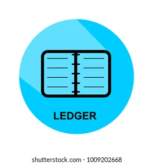

<p align="center">
  
</p>

<h1 align="center">Ledger</h1>

<p align="center">
  <strong>Diário Financeiro Pessoal • WebApp Moderna • Sincronização em Nuvem (Firebase) • Deploy no GitHub Pages</strong>
</p>

<p align="center">
  
  
  
  
  
  
  
</p>

---

## 📖 Visão Geral

O **Ledger** é uma aplicação completa de gestão financeira pessoal desenhada para ser rápida, segura, elegante e acessível em qualquer dispositivo.

Inicialmente construído como um diário financeiro local, o Ledger foi modernizado para operar como uma **WebApp completa hospedada no GitHub Pages**, sincronizada em tempo real com o **Google Firebase (Cloud Firestore e Firebase Authentication)**.

A interface gráfica foi reformulada com base na estrutura limpa do [Moleskine](https://github.com/willycornelissen/moleskine), abandonando molduras estáticas de smartphone no navegador em favor de um layout responsivo (`max-w-4xl`), com barra superior fixa, navegação por abas (*Extrato* e *Estatísticas*), botão de ação rápida *+ Novo Lançamento* e resumo financeiro do mês em grid de 3 colunas.

Todas as regras financeiras essenciais foram preservadas:
- Cálculos monetários realizados rigorosamente em **números inteiros de centavos**, eliminando imprecisões de arredondamento.
- Suporte a cache offline no navegador com sincronização automática com a nuvem quando online.
- Isolamento absoluto de dados: cada usuário autenticado acessa exclusivamente seu próprio banco de dados Firestore (`/users/{userId}/...`).

---

## ✨ Principais Funcionalidades

### 🔐 Autenticação Google & Proteção de Acesso
- Login seguro via pop-up com **Google Authentication**.
- **Controle Estrito de Acesso (`AuthGuard`)**: apenas o proprietário autorizado (cujo UID corresponda a `VITE_AUTHOR_UID`) tem permissão para acessar o sistema.
- Sessão persistente com exibição da foto de perfil, e-mail do usuário e botão de logout instantâneo.

### ☁️ Nuvem & Sincronização em Tempo Real (Firebase Firestore)
- Persistência na nuvem com isolamento sob a coleção do usuário autenticado.
- **Cache Local Robusto**: suporte a múltiplas abas concorrentes e funcionamento resiliente com `persistentMultipleTabManager` e `persistentLocalCache`.
- **Migração Automática e Transparente**: no primeiro login do proprietário em uma base vazia, o histórico existente é automaticamente migrado para o Firestore em lotes (*batch writes*), sem intervenção manual.
- Tratamento de permissões e avisos visuais claros em caso de inconsistência de regras de segurança.

### 🖥️ Interface Web Moderna (Inspirada no Moleskine)
- **Layout WebApp Nativo**: ocupa confortavelmente a tela (`max-w-4xl mx-auto`), sem emulação artificial de celular no desktop.
- **Header Superior Fixo (Sticky Bar)**:
  - Identidade visual Ledger com badge de conexão em nuvem.
  - Abas centrais de navegação: **Extrato** e **Estatísticas**.
  - Ação rápida: botão de destaque **+ Novo Lançamento**.
  - Menu de configurações (3 pontos) com atalhos para Categorias, Importação CSV, Backup e Relatório Anual.
  - Perfil do usuário com avatar do Google e logout.
- **Painel Mensal Integrado**:
  - Seletor de mês/ano com botões de navegação e atalho para o mês atual.
  - Grid responsivo de 3 colunas com cartões de **Saldo do Mês**, **Receitas** e **Despesas**.

### 💳 Lançamentos e Extrato Inteligente
- Registro de transações com categoria, data, valor monetário e notas descritivas.
- Agrupamento diário com soma de entradas/saídas por dia e botões rápidos de edição e exclusão.
- Navegação automática inteligente: caso o mês corrente não possua lançamentos, o app navega até o período mais recente com registros.

### 📊 Estatísticas e Indicadores (Dashboard)
- **Visão Mensal e Anual**: alternância dinâmica de análise.
- **Gráfico de Distribuição por Categorias (Donut Chart)**: proporção de despesas e receitas com paleta de cores consistente.
- **Evolução Temporal (Trend Bar Chart)**: tendências diárias ou mensais.
- **Métricas Chave**: taxa de poupança (*Savings Rate*), média de gastos diários e médias mensais.

### 📑 Relatórios Anuais Completos
- Consolidação dos 12 meses do ano selecionado.
- Exportações multiformato:
  - **PDF / Impressão**: folha estilizada pronta para salvar em PDF ou imprimir.
  - **CSV**: planilha consolidada com detalhamento mensal e por categorias.
  - **HTML Autônomo**: arquivo único independente com visualizador interativo embutido.

### 💾 Backup, Importação e Exportação
- **Backup JSON**: exportação e restauração completa de transações e categorias com um clique.
- **Exportação CSV**: download direto para compatibilidade com Excel, Google Sheets ou Calc.
- **Importador CSV Inteligente**:
  - Autodetecção de delimitadores (`,`, `;`, `\t`).
  - Reconhecimento automático de formatos de data (`DD/MM/YYYY`, `YYYY-MM-DD`).
  - Mapeamento flexível de colunas e categorização inteligente.

---

## 🛠️ Tecnologias Utilizadas

| Camada | Tecnologia | Finalidade |
|---|---|---|
| **Frontend** | [React 18](https://react.dev/) + [TypeScript](https://www.typescriptlang.org/) | Componentização reativa e tipagem estática rigorosa |
| **Estilização** | [Tailwind CSS](https://tailwindcss.com/) | Interface moderna, flexível e totalmente responsiva |
| **Ícones** | [Lucide React](https://lucide.dev/) | Ícones leves e consistentes em SVG |
| **Banco de Dados** | [Cloud Firestore](https://firebase.google.com/docs/firestore) | Armazenamento NoSQL escalável com cache local e regras por UID |
| **Autenticação** | [Firebase Authentication](https://firebase.google.com/docs/auth) | Provedor OAuth seguro com Google |
| **Build & Dev** | [Vite 6](https://vitejs.dev/) | Bundler moderno de altíssimo desempenho com HMR |
| **CI/CD & Hosting** | [GitHub Actions](https://github.com/features/actions) + [GitHub Pages](https://pages.github.com/) | Pipeline de build, teste e deploy estático automatizado |
| **Testes** | [Vitest](https://vitest.dev/) + [Testing Library](https://testing-library.com/) | 51 testes unitários e de integração com JSDOM e polyfills Node 22 |
| **Mobile Nativo** | [Capacitor 8](https://capacitorjs.com/) | Suporte a compilação de APK Android nativo |

---

## 📁 Estrutura do Projeto

```text
ledger/
├── .github/
│   └── workflows/
│       └── deploy.yml         # Pipeline CI/CD: testes, build e deploy no GitHub Pages
├── android/                   # Projeto nativo Android (Capacitor)
├── public/                    # Ativos estáticos e PWA
│   ├── icon.png               # Ícone da aplicação (alta resolução)
│   ├── icon-192.png           # Ícone PWA standard (192x192)
│   ├── icon-512.png           # Ícone PWA standard (512x512)
│   ├── icon-maskable-192.png  # Ícone PWA adaptativo Android (192x192)
│   ├── icon-maskable-512.png  # Ícone PWA adaptativo Android (512x512)
│   ├── icon.svg               # Logotipo em formato vetorial SVG
│   ├── ledger.webp            # Logotipo oficial
│   ├── manifest.json
│   └── sw.js
├── src/
│   ├── components/            # Componentes de interface do usuário
│   │   ├── AnnualReportModal.tsx     # Relatório anual e exportador PDF/HTML/CSV
│   │   ├── AnnualTrendBarChart.tsx   # Gráfico de evolução anual
│   │   ├── AuthGuard.tsx             # Proteção de acesso e tela de login Google
│   │   ├── BackupManagerModal.tsx    # Gerenciamento de backups JSON e CSV
│   │   ├── CategoryIcon.tsx          # Ícones de categoria dinâmicos
│   │   ├── CategoryManagerModal.tsx  # CRUD de categorias com paleta de cores
│   │   ├── CsvImportModal.tsx        # Importador inteligente de extratos CSV
│   │   ├── DashboardView.tsx         # Dashboard com gráficos e métricas
│   │   ├── DonutChart.tsx            # Gráfico de rosca SVG por categoria
│   │   ├── Header.tsx                # App Bar responsiva (estilo Moleskine)
│   │   ├── PwaInstallBanner.tsx      # Banner de instalação PWA
│   │   ├── TransactionForm.tsx       # Modal de inclusão e edição de transações
│   │   ├── TransactionList.tsx       # Extrato mensal agrupado por dia
│   │   └── TrendBarChart.tsx         # Gráfico de barras com tendência diária
│   ├── context/
│   │   └── FinanceContext.tsx # Contexto global com switch dinâmico Firestore/Local
│   ├── data/
│   │   └── seedData.ts        # Dados padrão de categorias e carga de histórico
│   ├── db/
│   │   └── indexedDb.ts       # Camada de fallback e persistência local (IndexedDB)
│   ├── hooks/
│   │   ├── useAuth.ts         # Hook de autenticação e verificação de UID proprietário
│   │   └── usePwaInstall.ts   # Hook para suporte a PWA
│   ├── services/
│   │   ├── firebase.ts        # Inicialização do SDK Firebase com cache offline
│   │   └── firestoreFinance.ts# Operações CRUD, lotes e migração no Firestore
│   ├── types/
│   │   └── finance.ts         # Tipos TypeScript (Transaction, Category, etc.)
│   ├── utils/
│   │   ├── csvParser.ts       # Parser de CSV com detecção de cabeçalhos e datas
│   │   ├── formatters.ts      # Formatadores de moeda (BRL em centavos) e datas
│   │   └── statistics.ts      # Fórmulas analíticas e agregações de dados
│   ├── App.tsx                # Estrutura principal da WebApp com AuthGuard
│   ├── index.css              # Estilos globais e utilitários Tailwind
│   └── main.tsx               # Ponto de entrada React
├── tests/                     # Bateria completa de testes automatizados
│   ├── setup.ts               # Setup global do Vitest (polyfills zstd / undici)
│   ├── annualReport.test.tsx
│   ├── components.test.tsx
│   ├── csvImport.test.tsx
│   ├── csvParser.test.ts
│   ├── dashboard.test.tsx
│   ├── pwa.test.tsx
│   ├── statistics.test.ts
│   └── storage.test.ts
├── .env.example               # Modelo de variáveis de ambiente do Firebase
├── capacitor.config.ts        # Configuração móvel do Capacitor
├── package.json               # Dependências e scripts npm
├── tailwind.config.js         # Configuração de temas e plugins Tailwind
└── vite.config.ts             # Configuração do Vite com base relativa para Pages
```

---

## ⚙️ Configuração do Firebase

Para conectar sua própria instância do Firebase:

### 1. Criar o Projeto no Firebase Console
1. Acesse o [Firebase Console](https://console.firebase.google.com/) e crie um novo projeto (ex: `ledger-b1583`).
2. Adicione uma aplicação **Web** (`</>`) e copie as chaves de configuração do SDK.

### 2. Ativar a Autenticação (Google Sign-In)
1. No menu lateral, acesse **Build > Authentication > Sign-in method**.
2. Ative o provedor **Google**.
3. Na aba **Settings > Authorized domains**, certifique-se de que constam:
   - `localhost`
   - `127.0.0.1`
   - `<seu-usuario>.github.io` (ex: `willycornelissen.github.io`)

### 3. Criar o Cloud Firestore e Configurar Regras de Segurança
1. No menu lateral, acesse **Build > Firestore Database** e crie o banco de dados.
2. Na aba **Rules**, defina as regras estritas de isolamento por UID:

```javascript
rules_version = '2';
service cloud.firestore {
  match /databases/{database}/documents {
    match /users/{userId}/{document=**} {
      allow read, write: if request.auth != null && request.auth.uid == userId;
    }
  }
}
```
3. Clique em **Publish**.

---

## 🔐 Variáveis de Ambiente

Crie um arquivo `.env` na raiz do projeto baseado no `.env.example`:

```env
VITE_FIREBASE_API_KEY=AIzaSy...
VITE_FIREBASE_AUTH_DOMAIN=seu-projeto.firebaseapp.com
VITE_FIREBASE_PROJECT_ID=seu-projeto
VITE_FIREBASE_STORAGE_BUCKET=seu-projeto.firebasestorage.app
VITE_FIREBASE_MESSAGING_SENDER_ID=000000000000
VITE_FIREBASE_APP_ID=1:000000000000:web:abcdef123456
VITE_FIREBASE_MEASUREMENT_ID=G-XXXXXXXXXX
VITE_AUTHOR_UID=seu_google_user_uid_aqui
```

> [!NOTE]
> O valor de `VITE_AUTHOR_UID` é o identificador único (UID) da sua conta Google gerado no Firebase Authentication. Somente o usuário com esse UID terá permissão para visualizar e registrar dados na aplicação.

---

## 🚀 Como Executar Localmente

### Pré-requisitos
- [Node.js](https://nodejs.org/) (versão 20 ou 22 recomendada)
- `npm`

### 1. Clonar e Instalar
```bash
git clone https://github.com/willycornelissen/ledger.git
cd ledger
npm install
```

### 2. Configurar o `.env`
Preencha o arquivo `.env` com as suas credenciais do Firebase conforme a seção anterior.

### 3. Iniciar o Servidor de Desenvolvimento
```bash
npm run dev
```
Abra no navegador em [http://localhost:5173/](http://localhost:5173/).

### 4. Executar os Testes
```bash
npm test
```
Todas as 51 suítes de testes unitários e de integração serão validadas via Vitest.

### 5. Compilar o Build de Produção
```bash
npm run build
```
Os arquivos estáticos otimizados serão gerados no diretório `dist/`. Para testar o build localmente:
```bash
npm run preview
```

---

## 🌐 Deploy no GitHub Pages

O projeto possui integração contínua (CI/CD) automatizada via GitHub Actions em [`.github/workflows/deploy.yml`](.github/workflows/deploy.yml).

### Passo a Passo para Ativar o Deploy Automático:

1. **Configurar os Segredos do Repositório (GitHub Secrets):**
   - No GitHub, acesse seu repositório: **Settings > Secrets and variables > Actions > New repository secret**.
   - Cadastre os mesmos nomes de variáveis do `.env`:
     - `VITE_FIREBASE_API_KEY`
     - `VITE_FIREBASE_AUTH_DOMAIN`
     - `VITE_FIREBASE_PROJECT_ID`
     - `VITE_FIREBASE_STORAGE_BUCKET`
     - `VITE_FIREBASE_MESSAGING_SENDER_ID`
     - `VITE_FIREBASE_APP_ID`
     - `VITE_FIREBASE_MEASUREMENT_ID`
     - `VITE_AUTHOR_UID`

2. **Ativar o GitHub Pages:**
   - Acesse **Settings > Pages**.
   - Em **Build and deployment > Source**, selecione: **GitHub Actions**.

3. **Deploy Automático:**
   - A cada `git push` na branch `main` (ou `master`), o workflow compilará, executará os testes e publicará o site automaticamente na URL:
     `https://<seu-usuario>.github.io/ledger/`

---

## 📱 Execução Móvel (Android / Capacitor)

O projeto também mantém suporte a compilação nativa para Android via Capacitor:

```bash
# Sincronizar o build web com a pasta de assets nativos do Android
npm run mobile:sync

# Abrir no Android Studio
npm run mobile:open

# Gerar o APK de Debug diretamente pelo terminal
npm run mobile:build
```
O APK será gerado em: `android/app/build/outputs/apk/debug/app-debug.apk`. Consulte [`android/mobile.md`](android/mobile.md) para detalhes de instalação via USB.

---

## 📄 Licença

Este projeto é de uso pessoal e privado, disponível sob os termos definidos no repositório.
